# JUNC Hamburger Club — アーキテクチャガイド

> 対象読者：Flutter・バックエンド開発初心者  
> 目的：このアプリがどんな部品でできているか、なぜその設計なのかを図と文章で理解する

---

## 目次

1. [システム全体構成](#1-システム全体構成)
2. [Flutterアプリの設計（MVVM）](#2-flutterアプリの設計mvvm)
3. [Riverpod 3.x 状態管理](#3-riverpod-3x-状態管理)
4. [画面遷移（GoRouter）](#4-画面遷移gorouter)
5. [バックエンド構成](#5-バックエンド構成)
6. [Webフロントエンド構成（Next.js）](#6-webフロントエンド構成nextjs)
7. [データベース設計](#7-データベース設計)
8. [認証フロー](#8-認証フロー)
9. [ファイル構造マップ](#9-ファイル構造マップ)
10. [設計上のルール（禁止事項）](#10-設計上のルール禁止事項)

---

## 1. システム全体構成

このプロジェクトは **3つのアプリケーション** で構成されています。

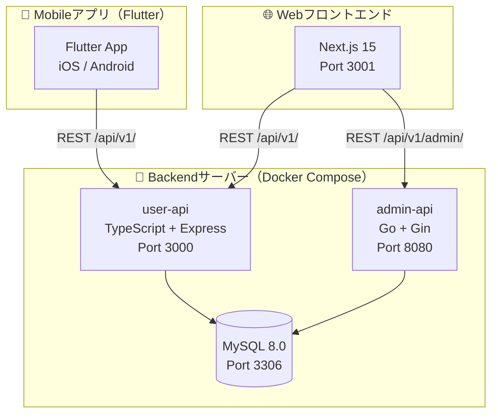

### 各コンポーネントの役割

| コンポーネント | 技術 | 担当 |
|---|---|---|
| **Mobileアプリ** | Flutter + Riverpod 3.x | ユーザーがバーガーを注文するアプリ |
| **user-api** | TypeScript + Express.js | モバイル・Webからのユーザー向けリクエストを処理 |
| **admin-api** | Go + Gin | 管理者向けAPI（メニュー管理・売上確認）|
| **MySQL 8.0** | Docker コンテナ | すべてのデータを保存するデータベース |
| **Next.js 15** | React + Tailwind CSS | ブラウザ版ユーザーUI・管理画面 |

---

## 2. Flutterアプリの設計（MVVM）

### MVVMとは？

**MVVM（Model-View-ViewModel）** は、コードを3つの役割に分けた設計パターンです。

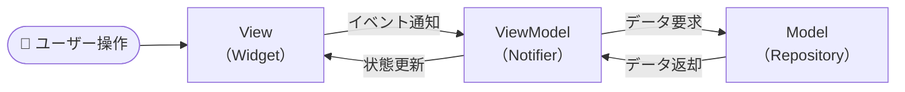

### このアプリのMVVM実装

```
lib/
├── presentation/          ◀── View（画面・ウィジェット）
│   ├── screens/           　　 実際に表示される画面
│   └── widgets/           　　 画面の部品
│
├── viewmodels/            ◀── ViewModel（状態管理・ビジネスロジック）
│   ├── home_viewmodel.dart
│   ├── cart_viewmodel.dart
│   ├── search_viewmodel.dart
│   ├── auth_viewmodel.dart
│   └── order_viewmodel.dart
│
├── data/                  ◀── Model（データ層）
│   ├── models/            　　 データクラス定義（copyWith パターン）
│   ├── repositories/      　　 データ取得インターフェース＋実装
│   └── sources/           　　 モックデータ（mock_data.dart）
│
└── providers/             ◀── Riverpodのプロバイダ一覧
    └── providers.dart
```

### データの流れ（バーガー一覧取得の例）

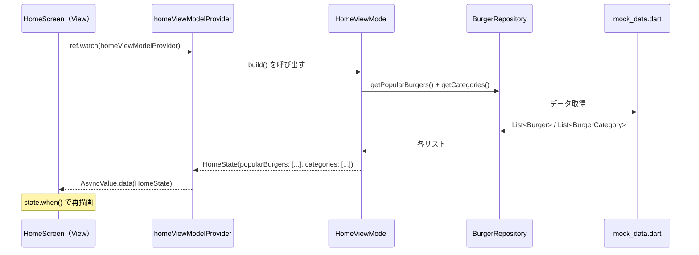

---

## 3. Riverpod 3.x 状態管理

### Riverpodの基本概念

**Riverpod** は Flutter の状態管理ライブラリです。「状態」とは「アプリが今持っているデータ」のことです。

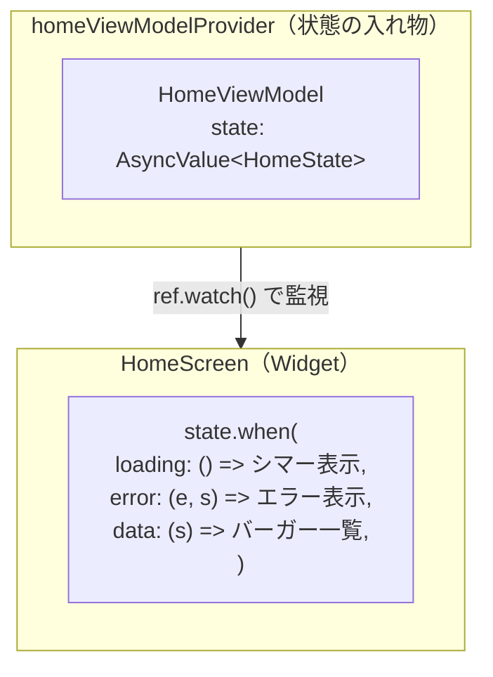

### このプロジェクトで使うProviderの種類

| Provider の種類 | 用途 | 例 |
|---|---|---|
| `NotifierProvider` | 同期的な状態管理 | カート内容、認証状態、検索クエリ |
| `AsyncNotifierProvider` | 非同期データ（API通信） | バーガー一覧、注文履歴 |
| `Provider` | 読み取り専用の値 | リポジトリのインスタンス |

### どのProviderを使うか？（選択フロー）

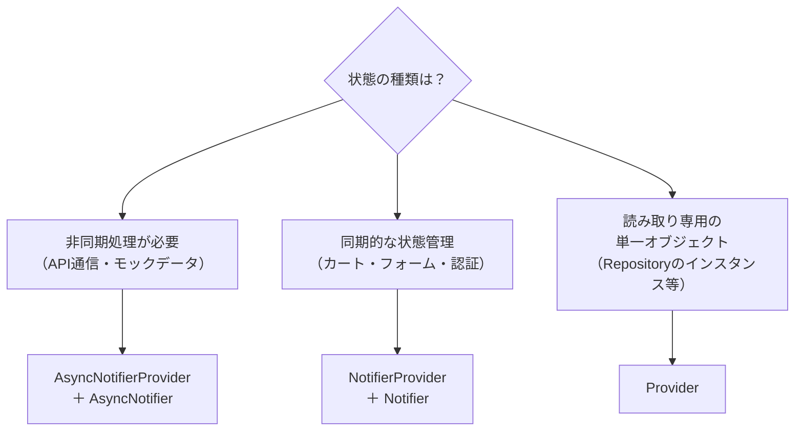

### ViewModelのコード例

#### パターン1: 同期的な状態管理（CartViewModel）

```dart
// ✅ 状態クラスを定義する（copyWith パターン）
class CartState {
  final List<CartItem> items;
  final bool isLoading;
  final String? error;

  const CartState({
    this.items = const [],
    this.isLoading = false,
    this.error,
  });

  // 一部だけ変更して新しいインスタンスを返す（イミュータブルな更新）
  CartState copyWith({
    List<CartItem>? items,
    bool? isLoading,
    String? error,
    bool clearError = false,
  }) {
    return CartState(
      items: items ?? this.items,
      isLoading: isLoading ?? this.isLoading,
      error: clearError ? null : (error ?? this.error),
    );
  }

  // 計算プロパティも State クラスに持たせる
  double get subtotal => items.fold(0.0, (sum, i) => sum + i.subtotal);
  double get tax      => subtotal * 0.1;
  double get total    => subtotal + tax;
}

// ✅ Notifier でカート状態を管理
class CartViewModel extends Notifier<CartState> {
  @override
  CartState build() => const CartState();  // 初期状態は空カート

  Future<void> addToCart(Burger burger, int quantity) async {
    state = state.copyWith(isLoading: true, clearError: true);
    try {
      final item = await ref
          .read(cartRepositoryProvider)
          .addToCart(burger, quantity);
      state = state.copyWith(
        items: [...state.items, item],
        isLoading: false,
      );
    } catch (e) {
      state = state.copyWith(isLoading: false, error: e.toString());
    }
  }
}
```

#### パターン2: 非同期データ取得（HomeViewModel）

```dart
// ✅ AsyncNotifier で API データを管理
class HomeViewModel extends AsyncNotifier<HomeState> {
  @override
  Future<HomeState> build() async {
    // build() の中に直接データ取得ロジックを書く
    final repo = ref.read(burgerRepositoryProvider);
    final results = await Future.wait([
      repo.getPopularBurgers(),
      repo.getCategories(),
    ]);
    return HomeState(
      popularBurgers: results[0] as List<Burger>,
      categories:     results[1] as List<BurgerCategory>,
    );
  }

  // リフレッシュは AsyncValue.guard() でラップする
  // ※ build() 内では guard() を使わない（再帰になるため）
  Future<void> refresh() async {
    state = const AsyncValue.loading();
    state = await AsyncValue.guard(() => build());
  }
}
```

> **禁止事項**: `StateNotifier`・`@riverpod`・`freezed` は使用しない（詳細は[10章](#10-設計上のルール禁止事項)）

---

## 4. 画面遷移（GoRouter）

### 画面一覧と遷移図

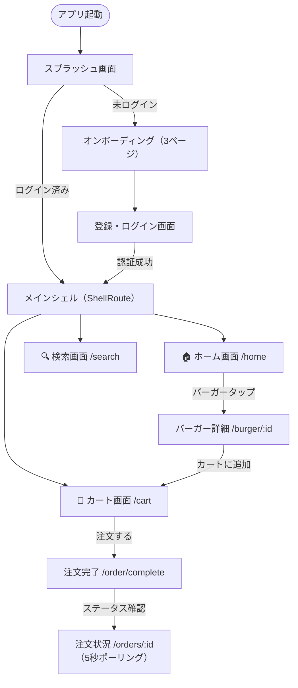

### ShellRouteとは？

`ShellRoute` はボトムナビゲーションバーを **共通で表示しながら** 各画面を切り替える仕組みです。

```
┌───────────────────────────────┐
│         バーガー一覧           │   ← 各画面のコンテンツ
│                               │
│  [画像] JUNCクラシック ¥680   │
│  [画像] ダブルチーズ ¥880     │
│                               │
├───────────────────────────────┤
│  🏠 ホーム  🔍 検索  🛒 カート │   ← MainShell（ShellRoute）が担当
└───────────────────────────────┘
```

### GoRouterのコード構造

```dart
// core/router/app_router.dart
final router = GoRouter(
  redirect: (context, state) {
    final isLoggedIn = ...;
    if (!isLoggedIn) return '/onboarding';
    return null;
  },
  routes: [
    GoRoute(path: '/onboarding', ...),
    GoRoute(path: '/register', ...),
    ShellRoute(  // ← ボトムナビを共通表示
      builder: (context, state, child) => MainShell(child: child),
      routes: [
        GoRoute(path: '/home', ...),
        GoRoute(path: '/search', ...),
        GoRoute(path: '/cart', ...),
      ],
    ),
  ],
);
```

---

## 5. バックエンド構成

### user-api（TypeScript + Express.js）

ユーザー向けAPIです。ポート **3000** で動作します。

```
junc_hamburger_club_backend/
└── user-api/
    └── src/
        ├── server.ts              ← サーバー起動エントリポイント
        ├── app.ts                 ← Expressアプリ設定・ミドルウェア
        ├── config/
        │   └── database.ts        ← MySQL接続設定
        ├── middleware/
        │   ├── auth.middleware.ts  ← JWTトークン検証
        │   └── error.middleware.ts ← エラーハンドリング
        ├── controllers/           ← リクエスト処理ロジック
        │   ├── auth.controller.ts
        │   ├── burger.controller.ts
        │   ├── cart.controller.ts
        │   ├── order.controller.ts
        │   └── user.controller.ts
        └── routes/                ← URLとControllerの紐付け
            ├── auth.routes.ts     /api/v1/auth/*
            ├── burger.routes.ts   /api/v1/burgers/*
            ├── cart.routes.ts     /api/v1/cart/*
            ├── order.routes.ts    /api/v1/orders/*
            └── user.routes.ts     /api/v1/users/*
```

### リクエストの流れ

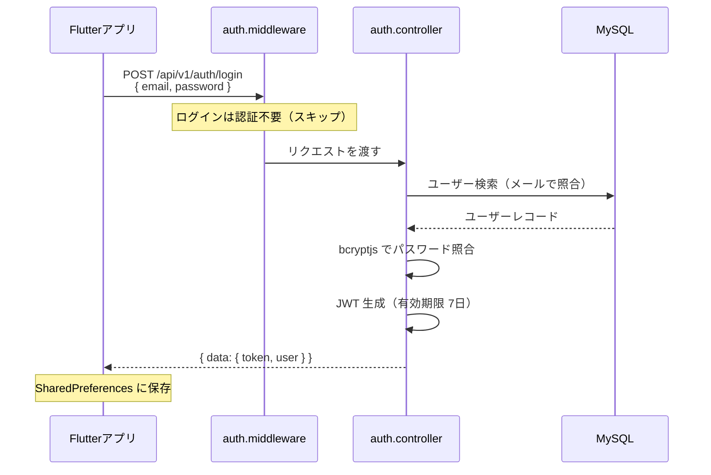

### admin-api（Go + Gin）

管理者向けAPIです。ポート **8080** で動作します。

```
admin-api/
├── main.go                    ← エントリポイント
├── config/config.go           ← 環境変数読み込み
├── models/models.go           ← データ構造定義
├── middleware/
│   ├── auth.go                ← JWT認証ミドルウェア
│   └── cors.go                ← CORS設定
├── handlers/                  ← HTTPハンドラー
│   ├── auth.go                POST /api/v1/admin/login
│   ├── dashboard.go           GET  /api/v1/admin/dashboard
│   ├── burger.go              CRUD /api/v1/admin/burgers
│   ├── order.go               GET/PATCH /api/v1/admin/orders
│   └── user.go                GET /api/v1/admin/users
├── router/router.go           ← ルーティング定義
└── docs/swagger.yaml          ← APIドキュメント
```

### Docker Compose 構成

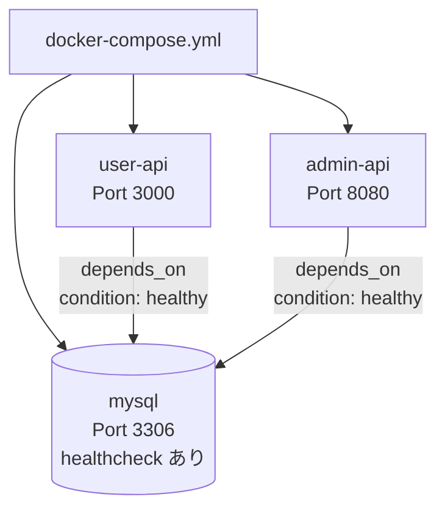

> **ポイント**: `mysql` が `healthy` になるまで他のサービスは起動を待機します（最大100秒）。

---

## 6. Webフロントエンド構成（Next.js）

### App Routerとは？

Next.js 15 の **App Router** は、ファイルの場所がそのままURLになる仕組みです。

```
junc_hamburger_club_webfront/
└── src/app/
    ├── layout.tsx                       ← 全体共通レイアウト
    │
    ├── (public)/                        ← 一般ユーザー向けページ
    │   ├── page.tsx                     /          トップページ
    │   ├── menu/
    │   │   ├── page.tsx                 /menu      メニュー一覧
    │   │   └── [id]/page.tsx            /menu/1    メニュー詳細
    │   └── auth/
    │       └── page.tsx                 /auth      ログイン・登録
    │
    └── (admin)/                         ← 管理者向けページ
        └── admin/
            ├── login/page.tsx           /admin/login       管理者ログイン
            ├── dashboard/page.tsx       /admin/dashboard   ダッシュボード
            ├── orders/page.tsx          /admin/orders      注文管理
            ├── burgers/page.tsx         /admin/burgers     バーガー管理
            └── users/page.tsx           /admin/users       ユーザー管理
```

### RSCとClient Componentの使い分け

| 種類 | マーカー | 特徴 | 使用箇所 |
|---|---|---|---|
| **RSC**（React Server Component） | なし | サーバーで描画・高速 | メニュー一覧・トップページ |
| **Client Component** | `"use client"` | ブラウザで動作・`useState`/`useEffect` 使用可 | 管理画面（ボタン操作・フォーム） |

---

## 7. データベース設計

### テーブル関連図（ER図）

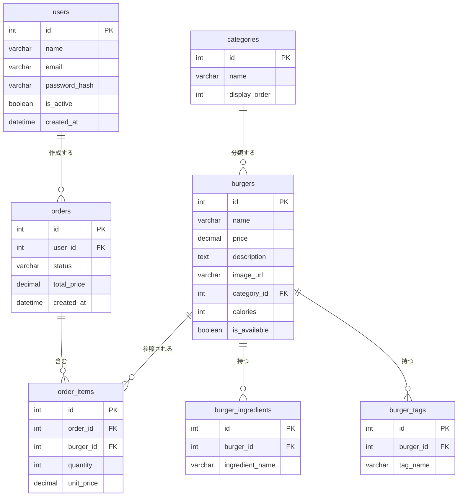

### 注文の状態遷移

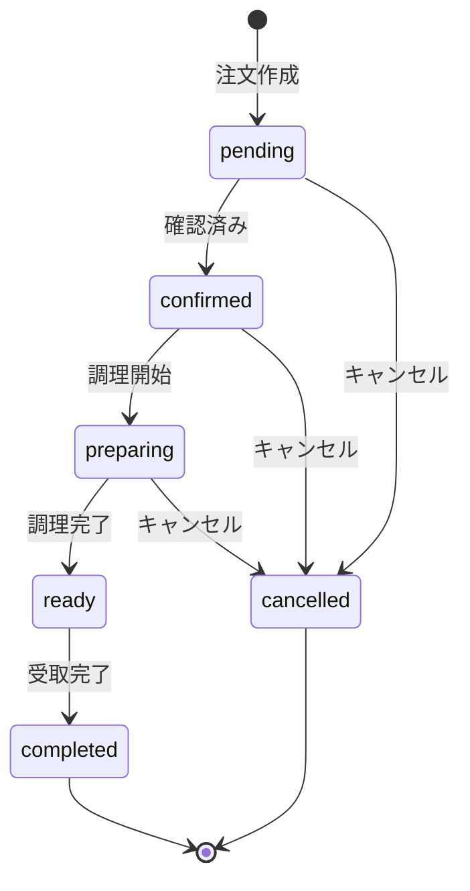

---

## 8. 認証フロー

### ユーザー登録・ログインの流れ

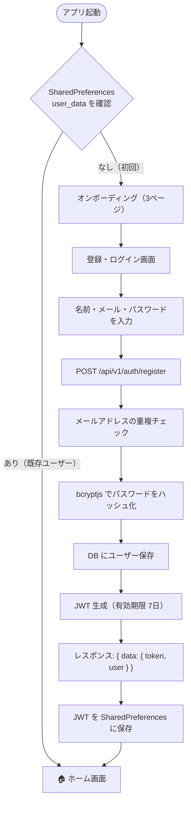

### JWTとは？

**JWT（JSON Web Token）** は、ユーザーの認証情報を安全にやり取りするための仕組みです。

```
eyJhbGciOiJIUzI1NiJ9.eyJ1c2VySWQiOjF9.abc123
│────────────────────│────────────────│───────│
   ヘッダー（方式）      ペイロード       署名
                      （ユーザーID等）  （改ざん検知）
```

- Flutterアプリは API リクエスト時に `Authorization: Bearer <token>` ヘッダーを送る
- user-api はトークンを検証してリクエストを許可/拒否する
- JWT の有効期限: **user-api = 7日、admin-api = 24時間**

---

## 9. ファイル構造マップ

### プロジェクト全体

```
junc_hamburger_club/
├── README.md                          ← セットアップ手順
├── architecture_guideline.md          ← このファイル
├── procedure_manual.md                ← 環境構築手順書
├── verification_manual.md             ← 検証手順書
├── guidance.md                        ← 開発ガイドライン
├── screenshots/                       ← アプリのスクリーンショット
│
├── junc_hamburger_club_mobile/        ← Flutterアプリ
│   ├── lib/
│   │   ├── main.dart                  ← アプリエントリポイント
│   │   ├── core/                      ← 共通設定
│   │   │   ├── constants/             ← API URLなどの定数
│   │   │   ├── router/                ← 画面遷移設定（GoRouter）
│   │   │   ├── services/              ← Dio HTTP クライアント
│   │   │   └── theme/                 ← デザインテーマ（AppColors）
│   │   ├── data/                      ← データ層
│   │   │   ├── models/                ← データクラス（copyWith パターン）
│   │   │   ├── repositories/          ← データ取得インターフェース＋実装
│   │   │   └── sources/               ← モックデータ（mock_data.dart）
│   │   ├── viewmodels/                ← ViewModel（状態管理）
│   │   ├── presentation/              ← UI層
│   │   │   ├── screens/               ← 各画面
│   │   │   └── widgets/               ← 共通ウィジェット（shimmer等）
│   │   └── providers/                 ← Riverpod Provider 定義
│   └── pubspec.yaml                   ← パッケージ定義
│
├── junc_hamburger_club_backend/       ← バックエンド
│   ├── docker-compose.yml             ← 全サービス起動設定
│   ├── Dockerfile.user-api            ← user-api のDockerfile
│   ├── .env.example                   ← 環境変数テンプレート
│   ├── init-db/                       ← DB初期化SQL
│   │   ├── 01_schema.sql              ← テーブル定義
│   │   └── 02_seed_data.sql           ← 初期データ（20種バーガー）
│   ├── user-api/                      ← TypeScript Express API
│   └── admin-api/                     ← Go Gin API
│
└── junc_hamburger_club_webfront/      ← Webフロントエンド
    └── src/
        ├── app/                       ← Next.js App Router
        ├── components/                ← 共通コンポーネント
        ├── hooks/                     ← カスタムフック（useAuth等）
        └── lib/                       ← ユーティリティ（api.ts等）
```

---

## 10. 設計上のルール（禁止事項）

このプロジェクトでは以下のパターンを **厳禁** としています。

### ❌ 禁止: freezed

```dart
// ❌ 使わない
@freezed
class Burger with _$Burger {
  factory Burger({required String name}) = _Burger;
}

// ✅ 代わりに通常のクラス + 手書き copyWith を使う
class Burger {
  final String name;
  const Burger({required this.name});

  Burger copyWith({String? name}) => Burger(name: name ?? this.name);
}
```

### ❌ 禁止: StateNotifier

```dart
// ❌ 使わない（古いRiverpodの書き方）
class CartNotifier extends StateNotifier<List<CartItem>> {
  CartNotifier() : super([]);
}

// ✅ 代わりに Notifier を使う（Riverpod 3.x）
class CartViewModel extends Notifier<CartState> {
  @override
  CartState build() => const CartState();
}
```

### ❌ 禁止: コード生成（@riverpod・build_runner）

```dart
// ❌ 使わない
@riverpod
Future<List<Burger>> burgers(BurgersRef ref) async { ... }

// ✅ 代わりに手動でProviderを定義する
final homeViewModelProvider = AsyncNotifierProvider<HomeViewModel, HomeState>(
  HomeViewModel.new,
);
```

### ❌ 禁止: valueOrNull（Riverpod 3.x で削除済み）

```dart
// ❌ コンパイルエラーになる
final current = state.valueOrNull ?? const HomeState();

// ✅ state.value を使う
final current = state.value ?? const HomeState();
```

### ❌ 禁止: build() 内での AsyncValue.guard()

```dart
// ❌ build() 内で guard() を使うと再帰呼び出しになる
class HomeViewModel extends AsyncNotifier<HomeState> {
  @override
  Future<HomeState> build() async {
    return AsyncValue.guard(() => build()); // 再帰！コンパイルは通るがバグ
  }
}

// ✅ build() は直接処理を書く。guard() はリフレッシュ専用
class HomeViewModel extends AsyncNotifier<HomeState> {
  @override
  Future<HomeState> build() async {
    final repo = ref.read(burgerRepositoryProvider);
    return HomeState(popularBurgers: await repo.getPopularBurgers());
  }

  Future<void> refresh() async {
    state = const AsyncValue.loading();
    state = await AsyncValue.guard(() => build()); // ← ここで使う
  }
}
```

### なぜこれらを禁止するのか？

| 禁止事項 | 理由 |
|---|---|
| `freezed` | コード生成が必要で複雑になる。手書き `copyWith` で十分 |
| `StateNotifier` | Riverpod 3.x では非推奨。`Notifier` が正式な後継 |
| `@riverpod` / `build_runner` | 生成コードはデバッグが難しく、学習コストが高い |
| `valueOrNull` | Riverpod 3.x で削除されたAPI。`state.value` を使う |
| `build()` 内の `guard()` | 再帰呼び出しになる。`refresh()` 等の別メソッドで使う |

---

## まとめ

| レイヤー | 技術 | 役割 |
|---|---|---|
| **Flutter** | Riverpod 3.x | 状態管理（Notifier / AsyncNotifier） |
| **Flutter** | GoRouter 14.x | 画面遷移（ShellRoute） |
| **Flutter** | MVVM パターン | 設計（View / ViewModel / Model） |
| **Backend** | TypeScript + Express | ユーザー向け RESTful API（/api/v1/） |
| **Backend** | Go + Gin | 高性能管理者API（/api/v1/admin/） |
| **Backend** | MySQL 8.0 | リレーショナルデータベース |
| **Backend** | Docker Compose | マルチコンテナ管理 |
| **Web** | Next.js 15 App Router | SSR/RSC + 管理画面 |
| **Web** | Tailwind CSS | ユーティリティファーストCSS |
