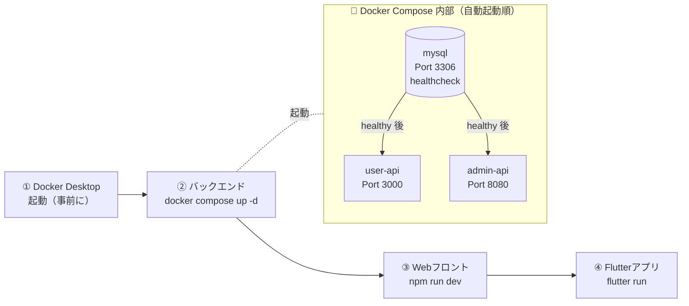

# JUNC Hamburger Club — 環境動作手順書

> 対象読者：開発環境を初めてセットアップする方  
> 目的：Mac上でFlutterアプリ・バックエンド・Webフロントエンドをすべて動かす

---

## 目次

1. [必要なツールの確認](#1-必要なツールの確認)
2. [リポジトリのクローン](#2-リポジトリのクローン)
3. [バックエンドの起動](#3-バックエンドの起動)
4. [Webフロントエンドの起動](#4-webフロントエンドの起動)
5. [Flutterモバイルアプリの起動](#5-flutterモバイルアプリの起動)
6. [iOSシミュレーターでの動作確認](#6-iosシミュレーターでの動作確認)
7. [Androidエミュレーターでの動作確認](#7-androidエミュレーターでの動作確認)
8. [よくあるエラーと解決方法](#8-よくあるエラーと解決方法)

---

## 起動の全体像

各コンポーネントの **起動順序** は以下の通りです。依存関係があるため、必ずこの順番で起動してください。



> **重要**: バックエンドが起動していないと、FlutterアプリとWebフロントが正常に動作しません。

---

## 1. 必要なツールの確認

以下のツールがインストールされているか確認します。

### 確認コマンド一覧

ターミナル（Terminal.app）を開いて、以下を実行してください。

```bash
flutter --version       # Flutter 3.x 以上
dart --version          # Dart 3.3.0 以上
node --version          # Node.js 20.x 以上
npm --version           # 10.x 以上
docker --version        # 20.x 以上
docker compose version  # v2.x 以上
go version              # 1.22 以上（admin-api のローカル開発時のみ）
xcode-select --version  # Mac/iOS開発用
adb --version           # Android開発用
```

### 必要なバージョン

| ツール | 最低バージョン | 確認方法 |
|---|---|---|
| Flutter | 3.x 以上 | `flutter --version` |
| Dart | 3.3.0 以上 | `dart --version` |
| Node.js | 20.0.0 以上 | `node --version` |
| Docker | 20.0.0 以上 | `docker --version` |
| Go | 1.22.0 以上 | `go version` |
| Xcode | 16.0 以上 | Mac App Store |

### インストールされていない場合

**Flutter のインストール:**
```bash
# 公式サイトのインストーラーが推奨
# https://docs.flutter.dev/get-started/install/macos

# Homebrew を使う場合
brew install --cask flutter
```

**Docker Desktop のインストール:**
```bash
# 公式サイト: https://www.docker.com/products/docker-desktop/
# インストール後、Docker Desktop アプリを起動すること
```

**Node.js のインストール:**
```bash
# volta（推奨）
curl https://get.volta.sh | bash
volta install node@20

# または Homebrew
brew install node
```

---

## 2. リポジトリのクローン

```bash
# 任意のディレクトリに移動（例: デスクトップ）
cd ~/Desktop

# リポジトリをクローン
git clone <リポジトリURL> junc_hamburger_club

# ディレクトリに移動
cd junc_hamburger_club

# フォルダ構造を確認
ls -la
```

**期待される出力:**
```
junc_hamburger_club/
├── README.md
├── architecture_guideline.md
├── procedure_manual.md
├── verification_manual.md
├── guidance.md
├── junc_hamburger_club_mobile/     ← Flutterアプリ
├── junc_hamburger_club_backend/    ← バックエンド
└── junc_hamburger_club_webfront/   ← Webフロントエンド
```

---

## 3. バックエンドの起動

バックエンドは **Docker** を使って起動します。MySQL・TypeScript API・Go APIが一括で起動します。

### ステップ 1: Docker Desktop を起動

Mac の Dock または Applications から **Docker Desktop** を起動します。  
メニューバーにクジラのアイコンが表示されたら準備完了です。

### ステップ 2: 環境変数ファイルを作成

```bash
# バックエンドディレクトリに移動
cd junc_hamburger_club_backend

# .env.example をコピーして .env を作成
cp .env.example .env

# .env ファイルを確認（必要に応じて編集）
cat .env
```

**.env の内容例:**
```dotenv
# データベース設定
MYSQL_ROOT_PASSWORD=rootpassword
MYSQL_DATABASE=junc_hamburger
MYSQL_USER=junc_user
MYSQL_PASSWORD=junc_password

# JWT 設定
JWT_SECRET=your-super-secret-key-change-this-in-production

# 管理者アカウント
ADMIN_EMAIL=admin@junc.com
ADMIN_PASSWORD=admin123

NODE_ENV=development
```

> **注意**: 本番環境では `JWT_SECRET` を必ず強力なランダム文字列に変更してください。

### ステップ 3: Dockerコンテナを起動

```bash
# コンテナをバックグラウンドで起動（初回はビルドに2〜3分かかります）
docker compose up -d --build
```

**起動の確認:**
```bash
# コンテナの状態を確認
docker compose ps
```

**正常に起動した場合の出力:**
```
NAME              STATUS              PORTS
junc_mysql        running (healthy)   0.0.0.0:3306->3306/tcp
junc_user_api     running             0.0.0.0:3000->3000/tcp
junc_admin_api    running             0.0.0.0:8080->8080/tcp
```

> **ポイント**: `mysql` の STATUS が `running (healthy)` になるまで少し時間がかかります（約30秒〜1分）。  
> 他のサービスはMySQLのヘルスチェックが通るまで起動を待機する設計になっています。

### ステップ 4: 動作確認

```bash
# user-api の動作確認
curl http://localhost:3000/health
# 期待するレスポンス: {"status":"ok","service":"junc-user-api"}

# admin-api の動作確認
curl http://localhost:8080/health
# 期待するレスポンス: {"status":"ok","service":"junc-admin-api"}

# バーガー一覧（認証不要）
curl http://localhost:3000/api/v1/burgers | jq '.data.burgers | length'
# 期待するレスポンス: 20
```

**Swagger UI（APIドキュメント）:**  
ブラウザで `http://localhost:3000/api-docs` を開くと、API仕様が確認できます。

```
利用可能な主要エンドポイント（Swagger UIで確認）:

  POST  /api/v1/auth/register      ← ユーザー登録
  POST  /api/v1/auth/login         ← ログイン
  GET   /api/v1/burgers            ← バーガー一覧
  GET   /api/v1/burgers/search     ← バーガー検索
  GET   /api/v1/burgers/categories ← カテゴリ一覧
  POST  /api/v1/cart               ← カートに追加（要認証）
  GET   /api/v1/cart               ← カート内容取得（要認証）
  POST  /api/v1/orders             ← 注文作成（要認証）
  GET   /api/v1/orders             ← 注文履歴（要認証）
```

### ステップ 5: ログの確認方法

```bash
# 全サービスのログ確認
docker compose logs

# 特定サービスのログ確認
docker compose logs user-api
docker compose logs admin-api
docker compose logs mysql

# リアルタイムでログを追う（Ctrl+C で停止）
docker compose logs -f
```

### コンテナの停止方法

```bash
# コンテナを停止（データは保持）
docker compose stop

# コンテナを停止して削除（データも削除したい場合）
docker compose down -v
```

---

## 4. Webフロントエンドの起動

### ステップ 1: 依存パッケージのインストール

```bash
# Webフロントエンドディレクトリに移動
cd ../junc_hamburger_club_webfront

# 依存パッケージをインストール
npm install
```

### ステップ 2: 環境変数ファイルを作成

```bash
cp .env.local.example .env.local
```

**.env.local の内容:**
```dotenv
# user-api の URL
NEXT_PUBLIC_USER_API_URL=http://localhost:3000/api/v1

# admin-api の URL
NEXT_PUBLIC_ADMIN_API_URL=http://localhost:8080/api/v1/admin
```

### ステップ 3: 開発サーバーを起動

```bash
npm run dev
```

**期待する出力:**
```
   ▲ Next.js 15.x.x
   - Local:        http://localhost:3001
   - Network:      http://192.168.x.x:3001

 ✓ Starting...
 ✓ Ready in x.xs
```

### ステップ 4: ブラウザで確認

| URL | 説明 |
|---|---|
| `http://localhost:3001` | 一般ユーザー向けトップページ |
| `http://localhost:3001/menu` | バーガーメニュー一覧 |
| `http://localhost:3001/admin/login` | 管理者ログイン画面 |
| `http://localhost:3001/admin/dashboard` | 管理者ダッシュボード |

**管理者ログイン情報:**
- メール: `admin@junc.com`
- パスワード: `admin123`（`.env` の `ADMIN_PASSWORD` で設定した値）

---

## 5. Flutterモバイルアプリの起動

### ステップ 1: Flutter の依存パッケージインストール

```bash
# Flutterアプリディレクトリに移動
cd ../junc_hamburger_club_mobile

# 依存パッケージをインストール
flutter pub get
```

### ステップ 2: Flutter 環境の診断

```bash
flutter doctor -v
```

**正常な出力の例:**
```
[✓] Flutter (Channel stable, 3.x.x)
[✓] Android toolchain
[✓] Xcode - develop for iOS and macOS
[✓] Chrome - develop for the web
[✓] Android Studio (version 2024.x)
[✓] VS Code (version 1.9x)
[✓] Connected device (x available)
```

> `[!]` や `[✗]` がある場合は、表示されるメッセージに従って対処してください。

### ステップ 3: 接続デバイスの確認

```bash
flutter devices
```

**出力例:**
```
3 connected devices:

iPhone 16 Pro (mobile)           • 00008140-... • ios           • iOS 18.x
sdk gphone64 arm64 (mobile)      • emulator-5554 • android-arm64 • Android 14
macOS (desktop)                  • macos         • darwin-arm64  • macOS 15.x
```

### ステップ 4: アプリの起動

```bash
# デバイスを選択して起動（対話式）
flutter run

# 特定のデバイスを指定する場合
flutter run -d "iPhone 16 Pro"  # iOSシミュレーター
flutter run -d emulator-5554    # Androidエミュレーター
```

> **Android エミュレーターの場合**: `localhost` ではなくホストPCのIPアドレス `10.0.2.2` を使います。  
> `lib/core/constants/api_constants.dart` の `baseUrl` を `http://10.0.2.2:3000` に変更してください。  
> または `adb reverse tcp:3000 tcp:3000` でポートを転送する方法もあります。

**起動後の表示（デバッグコンソール）:**
```
Flutter run key commands.
r  Hot reload. 🔥
R  Hot restart.
h  List all available interactive commands.
d  Detach (terminate "flutter run" but leave app running).
c  Clear the screen
q  Quit (terminate the app on the device).
```

### Hot Reload と Hot Restart の違い

| 操作 | キー | 説明 | 使いどころ |
|---|---|---|---|
| **Hot Reload** | `r` | コードの変更を即座に反映（状態保持） | UIの調整、ロジックの修正 |
| **Hot Restart** | `R` | アプリを再起動（状態リセット） | Provider・初期状態の変更 |
| **終了** | `q` | デバッグセッションを終了 | — |

---

## 6. iOSシミュレーターでの動作確認

### シミュレーターの起動方法

**方法1: ターミナルから起動**
```bash
# 利用可能なシミュレーター一覧
xcrun simctl list devices available

# シミュレーターアプリを起動
open -a Simulator

# 特定のシミュレーターを指定して起動
xcrun simctl boot "iPhone 16 Pro"
```

**方法2: Xcode から起動**
1. Xcode を開く
2. メニューバー → `Xcode` → `Open Developer Tool` → `Simulator`
3. メニューバー → `File` → `Open Simulator` → デバイスを選択

### アプリをシミュレーターで起動

```bash
cd junc_hamburger_club_mobile

# iOSシミュレーターにデプロイして起動
flutter run -d "iPhone 16 Pro"
```

### シミュレーターの操作方法

| 操作 | 方法 |
|---|---|
| タップ | マウスでクリック |
| スワイプ | マウスでドラッグ |
| ピンチイン/アウト | Option キーを押しながらドラッグ |
| ホームボタン | `Shift + Command + H` |
| スクリーンショット | `Command + S`（デスクトップに自動保存） |
| デバイス回転 | `Command + 左矢印` / `Command + 右矢印` |

### iOS でのデータリセット（初回起動状態に戻す）

```bash
# アプリを完全削除
xcrun simctl uninstall booted com.junc.junc-hamburger-club-mobile

# 再インストール
cd junc_hamburger_club_mobile
flutter run -d "iPhone 16 Pro"
```

---

## 7. Androidエミュレーターでの動作確認

### エミュレーターの作成（初回のみ）

1. **Android Studio** を開く
2. メニューバー → `Tools` → `Device Manager`
3. `+ Add device` → `Create Virtual Device` をクリック
4. デバイスを選択（例: `Pixel 9`）
5. システムイメージを選択（例: `API 35 / Android 15`、**ARM64 推奨**）
6. `Finish` をクリック

### エミュレーターの起動

**方法1: Android Studio から起動**
- Device Manager の一覧から ▶ ボタンをクリック

**方法2: ターミナルから起動**
```bash
# Android SDK のパスを設定（~/.zshrc に追記することを推奨）
export PATH="$PATH:$HOME/Library/Android/sdk/platform-tools"
export PATH="$PATH:$HOME/Library/Android/sdk/emulator"

# 利用可能なAVD一覧
emulator -list-avds

# エミュレーターを起動（バックグラウンド）
emulator -avd Pixel_9_API_35 &

# 起動完了を待つ
adb wait-for-device
```

### アプリをエミュレーターで起動

```bash
cd junc_hamburger_club_mobile

# Androidエミュレーターにデプロイして起動
flutter run -d emulator-5554
```

### ADB（Android Debug Bridge）の便利なコマンド

```bash
# 接続デバイス一覧
adb devices

# アプリのログを確認（Ctrl+C で停止）
adb logcat | grep -E "flutter|JUNC"

# スクリーンショットを撮って Mac に転送
adb shell screencap -p /sdcard/screenshot.png
adb pull /sdcard/screenshot.png ~/Desktop/

# アプリを強制終了
adb shell am force-stop com.junc.junc_hamburger_club

# ポートを転送（エミュレーターから localhost API に接続する場合）
adb reverse tcp:3000 tcp:3000
adb reverse tcp:8080 tcp:8080
```

### Android 16 でのオートフィル無効化

Android 16 ではテキストフィールドをタップすると Google の認証情報マネージャーが表示される場合があります。開発中は以下で無効化できます。

```bash
adb shell settings put secure autofill_service null
adb shell settings put secure credential_service null
```

---

## 8. よくあるエラーと解決方法

### Flutter 関連

#### `flutter pub get` でエラーが出る

```bash
flutter clean
flutter pub get
```

#### `No connected devices` と表示される

```bash
flutter devices                  # 接続デバイスを確認
open -a Simulator                # iOSシミュレーターを起動
emulator -avd Pixel_9_API_35 &  # Androidエミュレーターを起動
```

#### Hot Reload が効かない

```bash
# Hot Restart を試す（キー: R）
# それでもダメな場合は終了して再起動
q
flutter run
```

---

### Docker 関連

#### `docker compose up` でエラーが出る

```bash
# Docker Desktop が起動しているか確認
docker info

# ポートが使用中の場合
lsof -i :3000   # user-api のポート
lsof -i :8080   # admin-api のポート
lsof -i :3306   # MySQL のポート

# 既存のコンテナを削除して再起動
docker compose down
docker compose up -d --build
```

#### MySQL が起動しない / ヘルスチェックが通らない

```bash
# MySQL のログを確認
docker compose logs mysql

# ボリュームごと削除して初期化（データが消えるので注意）
docker compose down -v
docker compose up -d --build
```

#### `Permission denied` エラー

```bash
# Docker Desktop が起動しているか確認（メニューバーのクジラアイコンを確認）
docker info
```

---

### Node.js / Next.js 関連

#### `npm install` でエラーが出る

```bash
node --version   # v20 以上が必要

rm -rf node_modules package-lock.json
npm install
```

#### `port 3001 already in use`

```bash
lsof -i :3001       # 使用中のプロセスを確認
kill -9 <PID>       # プロセスを終了

# または別のポートで起動
PORT=3002 npm run dev
```

---

### Android 関連

#### `adb: command not found`

```bash
export PATH="$PATH:$HOME/Library/Android/sdk/platform-tools"

# 永続化する場合は ~/.zshrc に追記
echo 'export PATH="$PATH:$HOME/Library/Android/sdk/platform-tools"' >> ~/.zshrc
source ~/.zshrc
```

#### エミュレーターが `error: closed` と表示される

```bash
adb kill-server
adb start-server
# その後、Android Studio の Device Manager からエミュレーターを再起動
```

#### Android エミュレーターから API に接続できない

```bash
# 方法1: api_constants.dart の baseUrl を変更
#   static const String baseUrl = 'http://10.0.2.2:3000';

# 方法2: adb reverse でポートを転送
adb reverse tcp:3000 tcp:3000
adb reverse tcp:8080 tcp:8080
```

---

## まとめ: 起動チェックリスト

```
□ Docker Desktop が起動している
□ バックエンド: cd junc_hamburger_club_backend && docker compose up -d --build
□   → curl http://localhost:3000/health で {"status":"ok","service":"junc-user-api"} を確認
□   → curl http://localhost:8080/health で {"status":"ok","service":"junc-admin-api"} を確認
□ Webフロント: cd junc_hamburger_club_webfront && npm install && npm run dev
□   → http://localhost:3001 でトップページを確認
□ Flutter: cd junc_hamburger_club_mobile && flutter pub get && flutter run
□   → シミュレーター/エミュレーターでアプリが起動するのを確認
□   → Android の場合: baseUrl を http://10.0.2.2:3000 に変更（または adb reverse）
```
