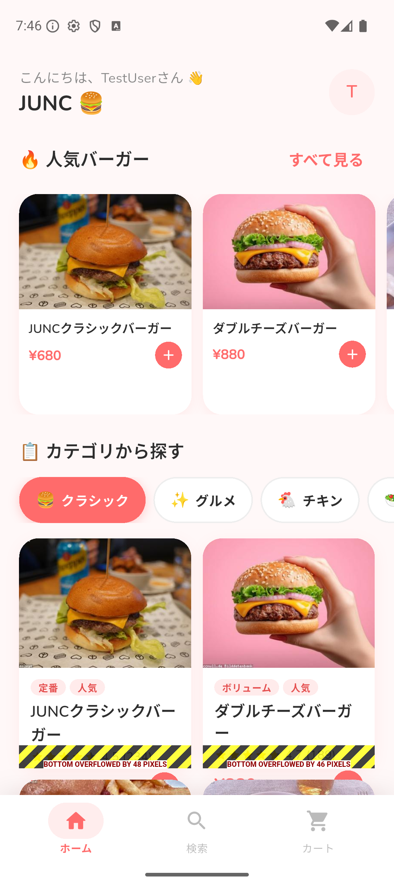
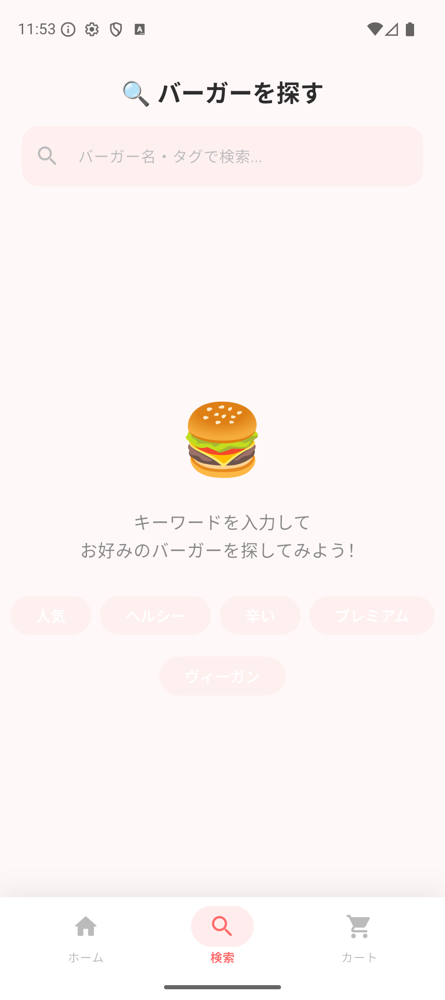
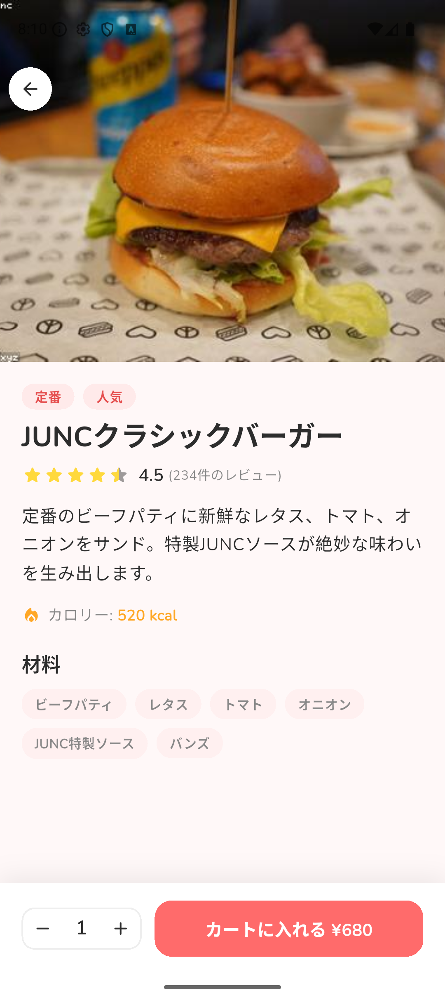
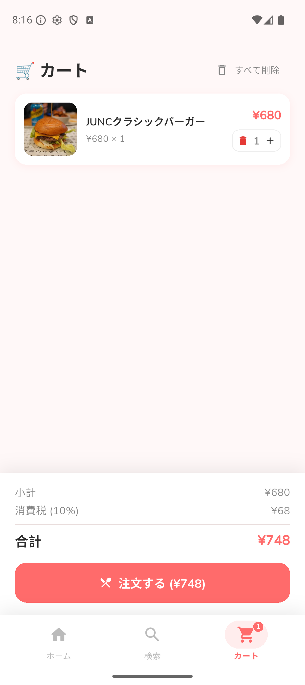
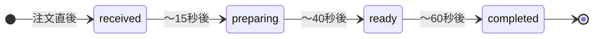

# JUNC Hamburger Club — 検証手順書

> 対象読者：アプリの動作を確認したい方（初心者向け）  
> 目的：各画面・機能が正しく動作することをスクリーンショット付きで確認する

---

## 目次

1. [検証の前提条件](#1-検証の前提条件)
2. [Mobileアプリの画面検証](#2-mobileアプリの画面検証)
   - [2-1 オンボーディング画面](#2-1-オンボーディング画面)
   - [2-2 ホーム画面](#2-2-ホーム画面)
   - [2-3 検索画面](#2-3-検索画面)
   - [2-4 バーガー詳細画面](#2-4-バーガー詳細画面)
   - [2-5 カート画面](#2-5-カート画面)
   - [2-6 注文完了・注文状況画面](#2-6-注文完了注文状況画面)
3. [バックエンドAPIの検証](#3-バックエンドapiの検証)
4. [Webフロントエンドの検証](#4-webフロントエンドの検証)
5. [Android エミュレーター検証手順](#5-android-エミュレーター検証手順)
6. [iOS シミュレーター検証手順](#6-ios-シミュレーター検証手順)
7. [検証チェックリスト（一覧表）](#7-検証チェックリスト一覧表)

---

## 1. 検証の前提条件

検証を始める前に、以下が完了していることを確認してください。

```
□ バックエンド起動済み（docker compose up -d）
□ curl http://localhost:3000/health → {"status":"ok","service":"junc-user-api"}
□ curl http://localhost:8080/health → {"status":"ok","service":"junc-admin-api"}
□ Webフロントエンド起動済み（npm run dev）
□ http://localhost:3001 にアクセスできることを確認
□ Flutterアプリがシミュレーター/エミュレーターで起動済み
```

詳細な起動手順は [procedure_manual.md](procedure_manual.md) を参照してください。

---

## 2. Mobileアプリの画面検証

### 2-1 オンボーディング画面

**検証シナリオ:** 初めてアプリを起動した際に表示されるウェルカム画面の確認

#### 検証手順

```
1. アプリのデータをリセットする
   - Android: 設定 → アプリ → JUNC → ストレージ → データを消去
   - iOS シミュレーター: アプリを長押し → 削除 → flutter run で再インストール

2. アプリを起動する

3. 以下を確認する:
   □ JUNC ロゴ・タイトルが表示される
   □ アプリの説明テキストが表示される
   □ 横スワイプでページが切り替わる（インジケーター連動）
   □ 最後のページで「はじめる」ボタンが表示される
   □ 「はじめる」ボタンをタップすると登録・ログイン画面へ遷移する
```

#### 期待する表示

```
┌────────────────────────┐
│                        │
│     🍔 JUNC            │
│  Hamburger Club        │
│                        │
│  本格バーガーをあなた  │
│  のスマホから。        │
│                        │
│     ● ○ ○             │  ← ページインジケーター
│                        │
│  ┌──────────────────┐  │
│  │    はじめる      │  │  ← 3ページ目のみ表示
│  └──────────────────┘  │
│                        │
└────────────────────────┘
```

---

### 2-2 ホーム画面

**検証シナリオ:** ログイン後のメイン画面の各要素を確認する

#### スクリーンショット



#### 確認項目

```
□ ローディング
   □ データ取得中にシマー（骨格）アニメーションが表示される

□ ヘッダー
   □ 「こんにちは、〇〇さん 👋」というグリーティングが表示される
   □ 「JUNC 🍔」タイトルが表示される
   □ 右上にユーザーアイコン（アバター）が表示される

□ 人気バーガーセクション
   □ 「🔥 人気バーガー」タイトルが表示される
   □ バーガーのサムネイル画像が表示される
   □ バーガー名・価格が表示される

□ カテゴリセクション
   □ 「📂 カテゴリから探す」タイトルが表示される
   □ カテゴリチップ（クラシック・グルメ・チキン・ベジタリアン）が表示される
   □ カテゴリをタップするとそのカテゴリのバーガーのみ表示される
   □ 同じカテゴリを再度タップするとトグルで解除される

□ ボトムナビゲーション
   □ 「ホーム」「検索」「カート」の3タブが表示される
   □ 現在のタブがハイライトされる（コーラルカラー）
```

---

### 2-3 検索画面

**検証シナリオ:** バーガーをキーワードで検索する機能を確認する

#### スクリーンショット



#### 確認項目

```
□ 初期表示
   □ 「🔍 バーガーを探す」タイトルが表示される
   □ 検索バーが表示される
   □ タグチップが表示される（人気・ヘルシー・辛い・プレミアム・ヴィーガン）

□ キーワード検索（400ms デバウンス）
   □ 「チーズ」と入力 → チーズを含むバーガーが表示される
   □ バーガー名・価格・説明が表示される

□ タグ検索
   □ 「人気」タグをタップ → 人気タグが付いたバーガーが表示される

□ 検索結果ゼロ
   □ `xxxxx` など存在しないキーワードを入力
   → 「該当するバーガーが見つかりませんでした」が表示される

□ クリア
   □ 検索バーをクリアすると初期状態に戻る
```

#### キーワード検索テストケース

| 検索キーワード | 期待する結果 |
|---|---|
| `チーズ` | チーズを含むバーガーが表示 |
| `チキン` | チキン系バーガーが表示 |
| `ヴィーガン` | ヴィーガン対応バーガーが表示 |
| `xxxxx` | 「見つかりませんでした」メッセージが表示 |
| （空白） | 初期状態に戻る |

---

### 2-4 バーガー詳細画面

**検証シナリオ:** バーガーをタップして詳細情報を確認する

#### スクリーンショット



#### 確認項目

```
□ ヘッダー
   □ SliverAppBar でバーガーの画像が大きく表示される
   □ スクロールダウンすると AppBar が収縮してタイトルが表示される
   □ 「←」戻るボタンが表示される

□ バーガー情報
   □ タグ（定番・人気など）が表示される
   □ バーガー名が表示される
   □ 星評価・レビュー数が表示される
   □ バーガーの説明文が表示される
   □ カロリー情報が表示される

□ 材料セクション
   □ 「材料」タイトルが表示される
   □ 材料チップが表示される（ビーフパティ・レタス・トマト・オニオン等）

□ カートに追加
   □ 数量調整ボタン（−・＋）が表示される
   □ 「−」で数量が減る（1未満にはならない）
   □ 「＋」で数量が増える
   □ 「カートに入れる ¥XXX」ボタンが表示される
   □ ボタンをタップするとスナックバーで「XXX をカートに追加しました」が表示される
   □ ボトムナビのカートアイコンにバッジ（数量）が表示される
   □ 同じバーガーをカートに追加済みの場合、「カートに入っています」状態になる
```

---

### 2-5 カート画面

**検証シナリオ:** カートの内容を確認・変更して注文する

#### スクリーンショット



#### 確認項目

```
□ カートの内容表示
   □ 「🛒 カート」タイトルが表示される
   □ 商品名・画像が表示される
   □ 単価 × 数量が表示される

□ 数量変更
   □ 「＋」ボタンで数量が1増える
   □ 「−」ボタンで数量が1減る
   □ 数量が1のとき「−」を押すと商品がカートから削除される
   □ 🗑 ボタンで商品を個別に削除できる
   □ 「すべて削除」でカートが空になる

□ 料金計算
   □ 「小計」が正しく計算されている
   □ 「消費税（10%）」が正しく計算されている
   □ 「合計」 = 小計 ＋ 消費税 となっている

□ 注文ボタン
   □ 「🍴 注文する（¥XXX）」ボタンが表示される
   □ タップすると確認ダイアログが表示される
   □ 確認後、注文完了画面へ遷移する

□ カートが空の場合
   □ 「カートは空です」メッセージが表示される
   □ 「メニューを見る」ボタンが表示される
```

#### 料金計算の確認例

| 商品 | 単価 | 数量 | 小計 |
|---|---|---|---|
| JUNCクラシックバーガー | ¥680 | 1 | ¥680 |
| 消費税（10%） | — | — | ¥68 |
| **合計** | — | — | **¥748** |

---

### 2-6 注文完了・注文状況画面

**検証シナリオ:** 注文を確定して注文状況を確認する

#### 確認項目

```
□ 注文完了画面
   □ ✅ アイコンと「注文が完了しました！」メッセージが表示される
   □ 注文番号が表示される
   □ 注文内容の概要が表示される（商品名・合計金額）
   □ 「注文状況を確認する」ボタンが表示される

□ 注文状況画面（5秒ポーリング）
   □ 注文ステータスが表示される
   □ ステータスに応じて進行バーが変化する
   □ 自動でステータスが更新される（ポーリング間隔: 5秒）
```

#### 注文ステータスの遷移（モック動作）



| 経過時間 | ステータス | 表示 |
|---|---|---|
| 0〜15秒 | 受付済み (received) | 📋 |
| 15〜40秒 | 調理中 (preparing) | 👨‍🍳 |
| 40〜60秒 | 受取可能 (ready) | 🔔 |
| 60秒〜 | 完了 (completed) | ✅ |

---

## 3. バックエンドAPIの検証

### curlコマンドを使った確認

以下のコマンドは **上から順番に** 実行してください。ログインで取得したトークンを自動的に次のコマンドで使います。

#### ヘルスチェック

```bash
curl -s http://localhost:3000/health | jq .
# 期待: {"status":"ok","service":"junc-user-api"}

curl -s http://localhost:8080/health | jq .
# 期待: {"status":"ok","service":"junc-admin-api"}
```

#### ユーザー登録

```bash
curl -s -X POST http://localhost:3000/api/v1/auth/register \
  -H "Content-Type: application/json" \
  -d '{
    "name": "テストユーザー",
    "email": "test@example.com",
    "password": "password123"
  }' | jq .
```

**期待するレスポンス:**
```json
{
  "data": {
    "token": "eyJhbGciOiJIUzI1NiJ9...",
    "user": {
      "id": 1,
      "name": "テストユーザー",
      "email": "test@example.com"
    }
  }
}
```

#### ログイン（トークンを変数に自動保存）

```bash
# ログインして TOKEN 変数に自動格納
TOKEN=$(curl -s -X POST http://localhost:3000/api/v1/auth/login \
  -H "Content-Type: application/json" \
  -d '{"email":"test@example.com","password":"password123"}' \
  | jq -r '.data.token')

echo "TOKEN: $TOKEN"
```

#### バーガー情報の取得（認証不要）

```bash
# カテゴリ一覧
curl -s http://localhost:3000/api/v1/burgers/categories \
  | jq '.data.categories[].name'

# バーガー一覧（20件確認）
curl -s http://localhost:3000/api/v1/burgers \
  | jq '.data.burgers | length'
# 期待: 20

# バーガー検索
curl -s "http://localhost:3000/api/v1/burgers/search?q=チーズ" \
  | jq '.data.burgers[].name'
```

#### カートと注文（認証が必要）

```bash
# カートにバーガーを追加
curl -s -X POST http://localhost:3000/api/v1/cart \
  -H "Content-Type: application/json" \
  -H "Authorization: Bearer $TOKEN" \
  -d '{"burgerId":"1","quantity":2}' | jq .

# カート内容を確認
curl -s http://localhost:3000/api/v1/cart \
  -H "Authorization: Bearer $TOKEN" | jq .

# 注文を作成
curl -s -X POST http://localhost:3000/api/v1/orders \
  -H "Content-Type: application/json" \
  -H "Authorization: Bearer $TOKEN" \
  -d '{"notes":"ソース多めでお願いします"}' | jq .

# 注文履歴を確認
curl -s http://localhost:3000/api/v1/orders \
  -H "Authorization: Bearer $TOKEN" \
  | jq '.data.orders[0].status'
# 期待: "received" または "pending"
```

#### Swagger UIでの確認

ブラウザで `http://localhost:3000/api-docs` を開くと、全APIをGUIで試すことができます。

```
手順:
1. http://localhost:3000/api-docs を開く
2. POST /api/v1/auth/login を展開する
3. "Try it out" ボタンをクリック
4. リクエストボディにメール・パスワードを入力
5. "Execute" ボタンをクリック
6. レスポンスの token をコピー
7. 画面上部の "Authorize" ボタンで Bearer <token> を設定
8. 認証が必要なAPIも試せるようになる
```

---

## 4. Webフロントエンドの検証

### 一般ユーザー向けページ

#### トップページ（`http://localhost:3001`）

```
確認項目:
□ ヘッダー（JUNC ロゴ・ナビゲーション）が表示される
□ ヒーローセクション（バーガー画像・キャッチコピー）が表示される
□ 「メニューを見る」ボタンがある
□ フッターが表示される
```

#### メニュー一覧（`http://localhost:3001/menu`）

```
確認項目:
□ バーガーの一覧が表示される（20件）
□ カテゴリでフィルタリングできる
□ バーガーをクリックすると詳細ページへ遷移する
```

### 管理者ページ

#### 管理者ログイン（`http://localhost:3001/admin/login`）

```
確認項目:
□ メール・パスワードの入力フォームが表示される
□ 正しい認証情報でログインできる
  - メール: admin@junc.com
  - パスワード: admin123
□ ログイン後、ダッシュボードへリダイレクトされる
□ 誤った認証情報ではエラーメッセージが表示される
□ 未認証で /admin/dashboard にアクセスすると /admin/login へリダイレクトされる
```

#### 管理者ダッシュボード（`http://localhost:3001/admin/dashboard`）

```
確認項目:
□ 総売上・注文数・ユーザー数のサマリーが表示される
□ 最近の注文一覧が表示される
□ 左サイドバーにナビゲーションメニューがある
```

#### 注文管理（`http://localhost:3001/admin/orders`）

```
確認項目:
□ 注文一覧が表示される
□ ステータスフィルターが動作する
□ 注文ステータスを更新できる
```

---

## 5. Android エミュレーター検証手順

### エミュレーター起動からアプリ確認までの手順

```bash
# Step 1: Android SDK パスを設定
export PATH="$PATH:$HOME/Library/Android/sdk/platform-tools"
export PATH="$PATH:$HOME/Library/Android/sdk/emulator"

# Step 2: エミュレーターを起動
emulator -avd Pixel_9_API_35 &

# Step 3: 起動完了を確認
adb wait-for-device
adb shell getprop sys.boot_completed
# "1" が返ってきたら起動完了

# Step 4: Flutterアプリをビルド＆インストール
cd junc_hamburger_club_mobile
flutter run -d emulator-5554
```

### エミュレーターでの確認ポイント

| 確認項目 | 手順 | 期待する結果 |
|---|---|---|
| アプリ起動 | エミュレーターでアプリアイコンをタップ | スプラッシュ後にオンボーディングが表示される |
| ユーザー登録 | 名前・メール・パスワードを入力 | ホーム画面へ遷移する |
| バーガー画像 | ホーム画面を表示 | バーガーの写真が表示される |
| カート操作 | バーガー詳細で「カートに追加」をタップ | カートアイコンにバッジが付く |
| 注文 | カート画面で「注文する」ボタンをタップ | 注文完了画面へ遷移する |
| ステータス自動更新 | 注文状況画面を15秒以上表示 | ステータスが「調理中」に自動更新される |

### スクリーンショットの取り方

```bash
adb shell screencap -p /sdcard/screenshot.png
adb pull /sdcard/screenshot.png ~/Desktop/screenshot.png
echo "スクリーンショットをデスクトップに保存しました"
```

### ログの確認方法

```bash
# Flutterのデバッグログ
adb logcat | grep -E "flutter|JUNC"

# クラッシュログ
adb logcat -s AndroidRuntime:E
```

---

## 6. iOS シミュレーター検証手順

### シミュレーター起動からアプリ確認までの手順

```bash
# Step 1: シミュレーターを起動
open -a Simulator

# Step 2: 起動中のデバイスを確認
xcrun simctl list devices booted

# Step 3: Flutterアプリをビルド＆インストール
cd junc_hamburger_club_mobile
flutter run -d "iPhone 16 Pro"
```

### iOS シミュレーターでの確認ポイント

| 確認項目 | 手順 | 期待する結果 |
|---|---|---|
| アプリ起動 | Simulator でアプリアイコンをタップ | スプラッシュ画面が表示される |
| Safe Area | iPhone の画面上下 | ノッチ・ダイナミックアイランドにコンテンツが被らない |
| フォント | テキスト表示 | 日本語フォント（Nunito）が正しく表示される |
| 画像 | バーガー画像 | loremflickr から画像が読み込まれる |
| ステータスバー | 画面上部 | 透明になっている |

### iOS シミュレーターでのスクリーンショット

```bash
# コマンドラインで撮影
xcrun simctl io booted screenshot ~/Desktop/ios_screenshot.png

# または Simulator のメニューから
# File → Save Screen Shot（Command + S）
```

### iOS でのデータリセット方法

```bash
# アプリを完全削除
xcrun simctl uninstall booted com.junc.junc-hamburger-club-mobile

# 再インストール
flutter install -d booted
```

---

## 7. 検証チェックリスト（一覧表）

### Mobileアプリ 全機能チェックリスト

#### オンボーディング

| # | 確認内容 | Android | iOS |
|---|---|---|---|
| 1 | アプリ初回起動でオンボーディング画面が表示される | □ | □ |
| 2 | 横スワイプでページが切り替わる（インジケーター連動） | □ | □ |
| 3 | 「はじめる」ボタンで登録・ログイン画面に遷移する | □ | □ |

#### ユーザー登録・認証

| # | 確認内容 | Android | iOS |
|---|---|---|---|
| 4 | 名前・メール・パスワードを入力して登録できる | □ | □ |
| 5 | 登録後、ホーム画面に遷移する | □ | □ |
| 6 | アプリを再起動しても自動でホーム画面が表示される（ログイン状態維持） | □ | □ |
| 7 | パスワード7文字未満などバリデーションエラーが表示される | □ | □ |

#### ホーム画面

| # | 確認内容 | Android | iOS |
|---|---|---|---|
| 8 | データ取得中にシマーローディングが表示される | □ | □ |
| 9 | 人気バーガーセクションにバーガーが表示される | □ | □ |
| 10 | バーガー画像が表示される | □ | □ |
| 11 | カテゴリチップでフィルタリングできる | □ | □ |

#### 検索画面

| # | 確認内容 | Android | iOS |
|---|---|---|---|
| 12 | キーワードでバーガーを検索できる（400msデバウンス） | □ | □ |
| 13 | タグチップをタップして絞り込みできる | □ | □ |
| 14 | 検索結果が0件の場合、適切なメッセージが表示される | □ | □ |

#### バーガー詳細画面

| # | 確認内容 | Android | iOS |
|---|---|---|---|
| 15 | バーガー画像・名前・説明が表示される | □ | □ |
| 16 | スクロールするとSliverAppBarが収縮する | □ | □ |
| 17 | カロリー・材料情報が表示される | □ | □ |
| 18 | 数量調整ボタン（−/+）が正しく動作する | □ | □ |
| 19 | カートに追加するとスナックバーが表示される | □ | □ |
| 20 | カートアイコンにバッジ（数量）が表示される | □ | □ |

#### カート画面

| # | 確認内容 | Android | iOS |
|---|---|---|---|
| 21 | カート内の商品一覧が表示される | □ | □ |
| 22 | 「＋」「−」ボタンで数量が変更できる | □ | □ |
| 23 | 数量1で「−」を押すと商品が削除される | □ | □ |
| 24 | 「すべて削除」でカートが空になる | □ | □ |
| 25 | 小計・消費税（10%）・合計が正しく計算される | □ | □ |
| 26 | 「注文する」で確認ダイアログが表示される | □ | □ |
| 27 | 注文確定で注文完了画面へ遷移する | □ | □ |
| 28 | カートが空のとき適切なメッセージが表示される | □ | □ |

#### 注文完了・注文状況

| # | 確認内容 | Android | iOS |
|---|---|---|---|
| 29 | 注文完了画面に注文番号が表示される | □ | □ |
| 30 | 注文状況画面でステータスが表示される | □ | □ |
| 31 | 15秒後にステータスが「調理中」に自動更新される | □ | □ |
| 32 | 40秒後にステータスが「受取可能」に自動更新される | □ | □ |

---

### バックエンドAPI チェックリスト

| # | エンドポイント | 確認内容 | 結果 |
|---|---|---|---|
| 1 | `GET /health` | `{"status":"ok","service":"junc-user-api"}` が返る | □ |
| 2 | `POST /api/v1/auth/register` | 正常に登録できる | □ |
| 3 | `POST /api/v1/auth/login` | JWTトークンが返る | □ |
| 4 | `GET /api/v1/burgers` | バーガー一覧が20件返る | □ |
| 5 | `GET /api/v1/burgers/search?q=チーズ` | チーズ系バーガーが返る | □ |
| 6 | `GET /api/v1/burgers/categories` | カテゴリ一覧が返る | □ |
| 7 | `GET /api/v1/burgers/:id` | バーガー詳細が返る | □ |
| 8 | `POST /api/v1/cart` | カートに追加できる（要認証） | □ |
| 9 | `GET /api/v1/cart` | カート内容が取得できる（要認証） | □ |
| 10 | `POST /api/v1/orders` | 注文が作成できる（要認証） | □ |
| 11 | `GET /api/v1/orders` | 注文履歴が取得できる（要認証） | □ |
| 12 | Swagger UI | `http://localhost:3000/api-docs` にアクセスできる | □ |

---

### Webフロントエンド チェックリスト

| # | URL | 確認内容 | 結果 |
|---|---|---|---|
| 1 | `http://localhost:3001` | トップページが表示される | □ |
| 2 | `http://localhost:3001/menu` | メニュー一覧が表示される（20件） | □ |
| 3 | `http://localhost:3001/menu/1` | バーガー詳細が表示される | □ |
| 4 | `http://localhost:3001/auth` | ログイン・登録画面が表示される | □ |
| 5 | `http://localhost:3001/admin/login` | 管理者ログイン画面が表示される | □ |
| 6 | 管理者ログイン | `admin@junc.com` でログインできる | □ |
| 7 | `http://localhost:3001/admin/dashboard` | ダッシュボードが表示される | □ |
| 8 | `http://localhost:3001/admin/orders` | 注文管理画面が表示される | □ |
| 9 | `http://localhost:3001/admin/burgers` | バーガー管理画面が表示される | □ |
| 10 | `http://localhost:3001/admin/users` | ユーザー管理画面が表示される | □ |
| 11 | 未認証でのアクセス | `/admin/dashboard` → `/admin/login` にリダイレクトされる | □ |

---

## 参考情報

### スクリーンショット一覧

このドキュメントで参照しているスクリーンショットは `screenshots/` ディレクトリに保存されています。

| ファイル名 | 画面 |
|---|---|
| `screenshots/screen_home.png` | ホーム画面 |
| `screenshots/screen_search.png` | 検索画面 |
| `screenshots/screen_detail.png` | バーガー詳細画面 |
| `screenshots/screen_cart.png` | カート画面 |

### 関連ドキュメント

- [README.md](README.md) — プロジェクト概要・セットアップ
- [architecture_guideline.md](architecture_guideline.md) — アーキテクチャガイド
- [procedure_manual.md](procedure_manual.md) — 環境動作手順
